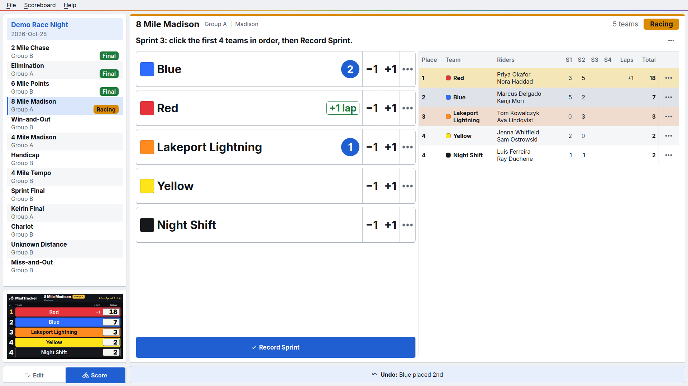
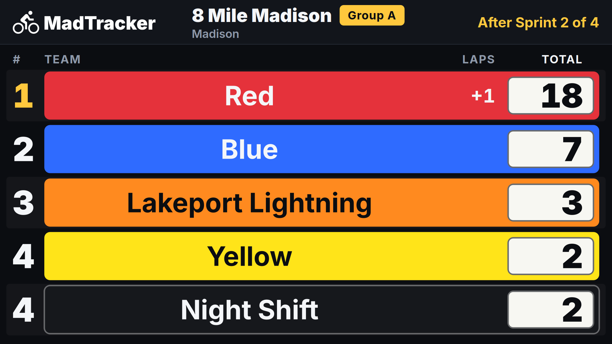
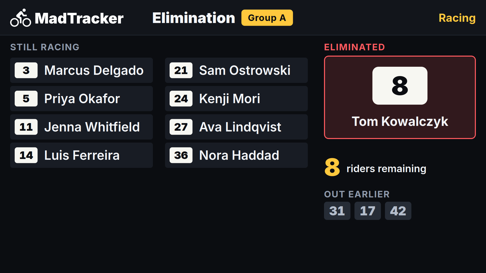
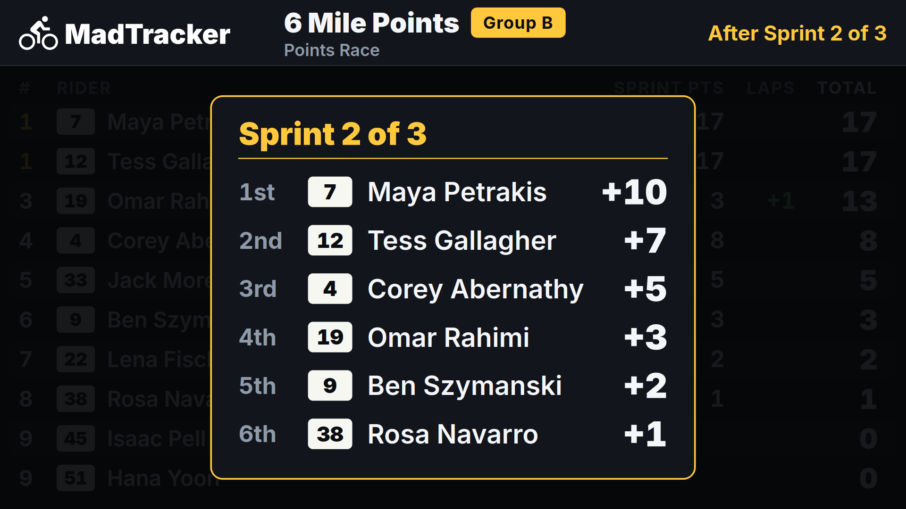
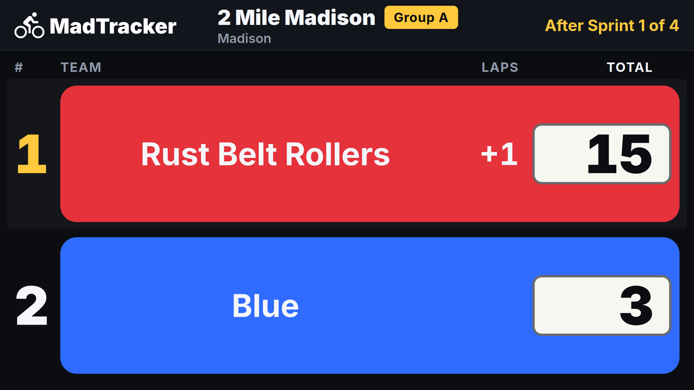
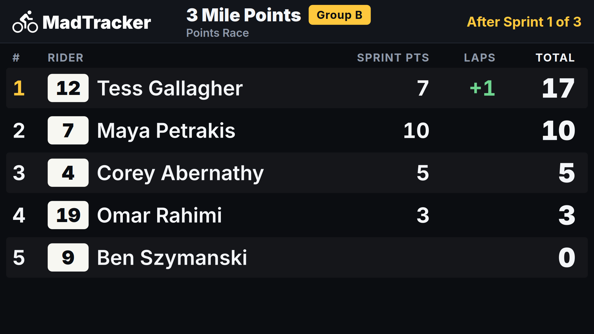
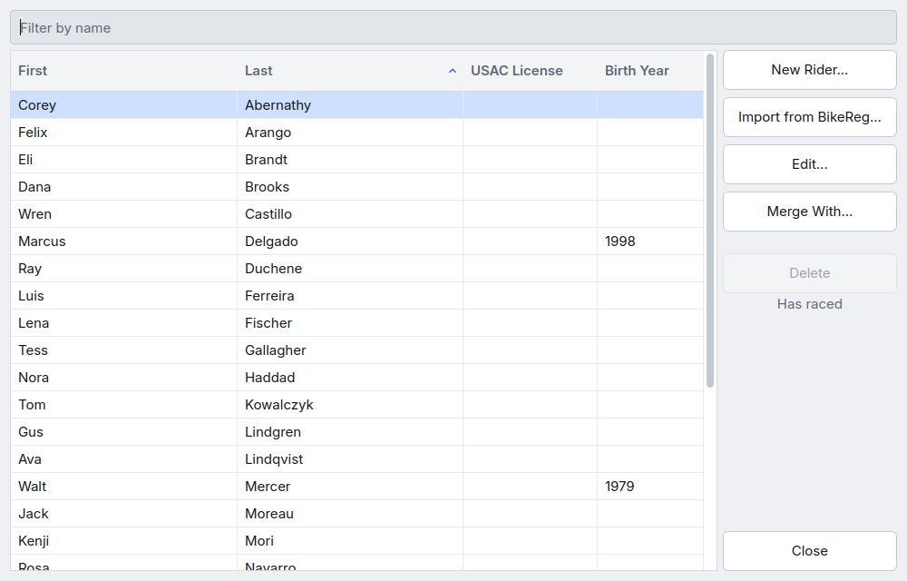
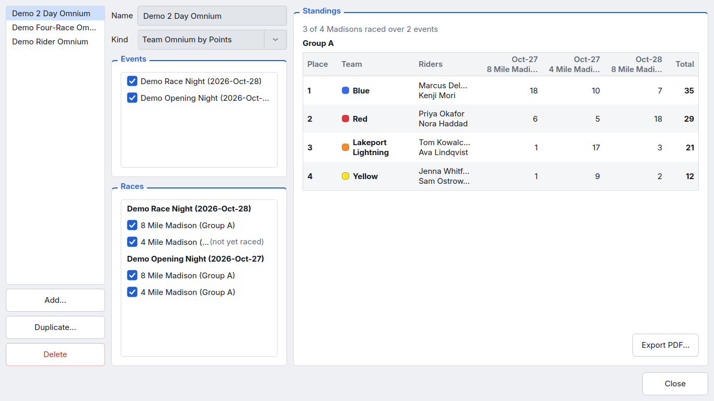
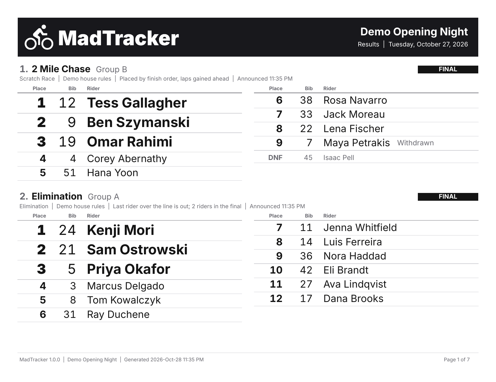
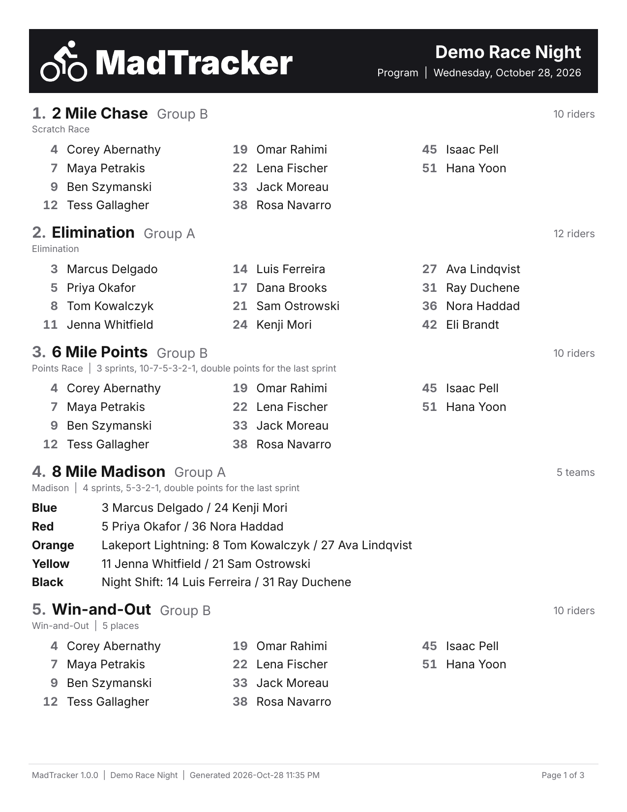

# MadTracker

MadTracker is software for scoring [track cycling](https://en.wikipedia.org/wiki/Track_cycling) races. The scorer clicks riders as the officials call each placing, and MadTracker works out the result and shows it on a scoreboard for the crowd.

**NOTE**: MadTracker is not a USA Cycling product and is not endorsed by USA Cycling. It aims to score races exactly as the [USA Cycling Rulebook, version 8•25](https://assets.usacycling.org/prod/documents/USACycling_RuleBook_8_2025.pdf), describes, citing the rulebook's articles directly. It also scores a few club formats.

## About

MadTracker started as a way to make scoring easier at Detroit's [Mad Track Arena](https://madtrackarena.com/), replacing a set of spreadsheets that calculated the results and displayed them on a scoreboard. The spreadsheets worked well, but there was room for improvement, particularly around ease of use and handing the job off to a new scorer.

As the officials call each sprint, elimination, lap gained or lost, or finish, the scorer clicks the riders and the program does the rest: it calculates the scores, shows the scoreboard on a second display, and keeps a history of what was scored and when.

MadTracker follows a clear order. A venue's settings cascade to its events. Each event has a roster of riders and a program of races, and each race's field comes from that roster. Races are scored one at a time, and Multi-Race Standings combine results across races and events. Every format is scored with similar steps, so once you've scored one kind of race, the others are familiar. Each race also keeps the rules it was scored under, and each event keeps its riders' bibs and groups. So as riders change categories or the rules change, the history of what happened and how it was scored isn't lost.

Before the racing it exports the night's program, and afterward an archival results sheet, both as PDFs. It imports riders from BikeReg, and it exports a CSV ready to upload to USA Cycling's results site.

MadTracker doesn't do timing or enforce rules; it's a scoring system. It needs no network connection and saves everything on the computer it runs on.

## Screenshots

<!-- screenshots:start -->

The scoring window at 1920 by 1080, partway through a Madison in the demo event: two sprints recorded, a lap gained by the leading team, the third sprint's first two teams clicked, and the standings so far. Two teams have names of their own; the rest go by their color.

The scoreboard on the second display at 1920 by 1080, after the second sprint of the same Madison.

<table>
<tr>
<td valign="top"> The scoreboard during an Elimination.</td>
<td valign="top"> The scoreboard briefly shows sprint results mid-race.</td>
</tr>
<tr>
<td valign="top"> A Madison with two teams; one custom and one by color. Row size scales automatically.</td>
<td valign="top"> A Points Race scoreboard with five riders.</td>
</tr>
<tr>
<td valign="top"> File > Edit Riders..., where the venue's riders are added, imported, and edited.</td>
<td valign="top"> File > Multi-Race Standings..., with the demo's two-night Team Omnium partway through.</td>
</tr>
<tr>
<td valign="top"> First page of a final result's PDF.</td>
<td valign="top"> First page of a demo race program PDF.</td>
</tr>
</table>

(Screenshots without the operating system's window frame.)

<!-- screenshots:end -->

## What it scores

MadTracker currently supports all mass-start track cycling formats in the USA Cycling Rulebook:

- Scratch Race
- Handicap
- Elimination (Miss-and-Out)
- Sprint Final
- Keirin Final
- Points Race
- Madison
- Tempo Race

It also supports three club formats:

- Unknown Distance
- Chariot
- Win-and-Out

The Scoring page in the program's help says where each format comes from and how it's scored, and [the rule register](docs/scoring-rules.md) lists every rule with its article and the test that pins it.

## Multi-Race Standings

MadTracker also calculates standings over several races and nights:

- Team Omnium (by points or by place)
- Omnium by Place
- Four-Race Omnium

## Race types it doesn't score

MadTracker doesn't currently score:

- Timed events, such as pursuits, time trials, and team sprints. Their results are times, and MadTracker has no way to enter a time.
- Brackets, such as sprint or keirin tournaments.

## Installing

Download it from the [GitHub Releases page](https://github.com/c0nsumer/madtracker/releases) and install it: a setup `.exe` or a portable zip on Windows, a `.dmg` on a Mac with Apple silicon, or a tarball on Linux.

**NOTE**: The builds aren't code-signed, so macOS and Windows warn about them the first time they're opened. [Installing](docs/installing.md) walks through getting past that.

## Demo data

To look around before setting MadTracker up for a venue, use **Help** > **Demo Data File...**. It opens a sample data file with invented riders and a race of every format.

## Help and documentation

The scorer's help ships in the application and is also readable here:

- [Getting Started](madtracker/help/getting-started.md)
- [Scoring](madtracker/help/scoring.md)
- [Results](madtracker/help/results.md)
- [Multi-Race Standings](madtracker/help/multi-race-standings.md)
- [Backups](madtracker/help/backups.md)

The pages below are for officials or developers who want to check a rule, and for machines or individuals wanting to read the data file or work on the code. (Unlike this README and the in-app help, ***these*** are mostly AI written.)

- [Scoring rules](docs/scoring-rules.md): the rule register, with the rulebook articles and the test that pins each rule.
- [The data file](docs/data-file.md): the SQLite file, table by table, for reading it without the app.
- [Importing riders from a spreadsheet](docs/rider-import.md): the CSV columns the rider import reads, with a template, for lists that don't come from BikeReg.
- [Architecture](docs/architecture.md): how the program is built.
- [Building](docs/building.md): the development setup and the build on each system.
- [Releasing](docs/releasing.md): the checks, the candidates, and the tag, for whoever cuts a release.
- [Changelog](docs/changelog.md): what changed in each build, in the scorer's words.

## For developers

The setup, test, and lint commands are in [Building](docs/building.md), along with how to build a package on each system. The code is laid out like this:

| Directory | What it is |
|---|---|
| `madtracker/scoring/` | Pure scoring engines: race rules plus the scorer's entries give the standings. No Qt, no SQLite. |
| `madtracker/store/` | SQLite persistence: schema, the append-only action log, backup, and restore. |
| `madtracker/control/` | Ties the store and scoring together: the race session, rulesets, roster, backups policy, scoreboard feed, multi-race standings, the demo data file. No Qt. |
| `madtracker/importers/` | The BikeReg entries import. |
| `madtracker/ui/` | The operator window and the setup dialogs. |
| `madtracker/board/` | The audience scoreboard window. |
| `madtracker/export/` | PDF and USA Cycling CSV outputs, and the multi-race standings sheet. |
| `madtracker/help/` | The scorer's help pages, shipped with the program and shown from the Help menu. |
| `madtracker/assets/` | The app icon, the interface icons, the bundled typeface, the license texts, and the placeholder wordmark. |
| `packaging/` | The PyInstaller spec, the Inno Setup installer, and the build script for each platform. |
| `tools/` | Scripts for the maintainer: the icons, the placeholder wordmark, the installer pictures, a ruleset file from the command line, the README screenshots, and the hand test harnesses that run before a release (the scoring oracles and the mutation runner under `tools/scoring/`, the session replay, the click monkey, and the undo monkey). |
| `tests/` | pytest suite. Qt tests run offscreen. |
| `docs/` | The design, the architecture, the data file, the rule register, building, installing, releasing, and the changelog. |
| `docs/research/` | The rulebook, USAC export, and format research the design rests on. |

## Credits

MadTracker is developed by Steve Vigneau ([nuxx.net](https://nuxx.net)), with Claude Code, an AI coding tool.

This would not have been possible without working in partnership with Glenn OConner, the current scoring wizard at Mad Track Arena. An additional thank-you to Kevin Morrison, whose feedback on scoring methodology guided and polished MadTracker getting it ready for release.

It's built on these open-source components:

| Component | License | Used for |
|---|---|---|
| [Python](https://www.python.org) | PSF License | The language, and its runtime inside the packaged builds |
| [PySide6 and shiboken6](https://doc.qt.io/qtforpython-6/) (Qt for Python), with [Qt](https://www.qt.io) | LGPL-3.0 | Windows, widgets, multi-display |
| [fpdf2](https://py-pdf.github.io/fpdf2/) | LGPL-3.0 | PDF results |
| [uharfbuzz](https://github.com/harfbuzz/uharfbuzz) | Apache License 2.0 | Text shaping for the PDF, so its digits line up in columns |
| [HarfBuzz](https://harfbuzz.github.io/), bundled inside uharfbuzz | Old MIT | The shaping engine uharfbuzz wraps |
| [fontTools](https://github.com/fonttools/fonttools) | MIT | Font subsetting for the PDF (an fpdf2 dependency) |
| [Pillow](https://python-pillow.github.io/) | MIT-CMU | Images in the PDF (an fpdf2 dependency) |
| [defusedxml](https://github.com/tiran/defusedxml) | PSF-2.0 | Safe XML parsing (an fpdf2 dependency) |
| [Material Design Icons](https://pictogrammers.com/library/mdi/) by the Pictogrammers | Pictogrammers Free License (Apache 2.0) | App icon ("bike") and interface icons |
| [PyObjC](https://pyobjc.readthedocs.io/) (optional, macOS only) | MIT | App name in the macOS menu bar when run from a venv |
| [Inter](https://github.com/rsms/inter) by Rasmus Andersson | SIL Open Font License 1.1 | The typeface of the window, the scoreboard, and the PDF, bundled |

## License

MIT. See `LICENSE`.

The license texts of the third-party components above are bundled under `madtracker/assets/licenses/` (Inter's is beside the font files, in `madtracker/assets/fonts/`).
The installed program shows them under **Licenses...** in **Help** > **About MadTracker**.

## Name collision

There's another MadTracker: a music tracker for Windows, at madtracker.org. Because our two programs aren't related, and I'm very fond of this name (an homage to Mad Track Arena and Madison races) I've accepted the name collision.